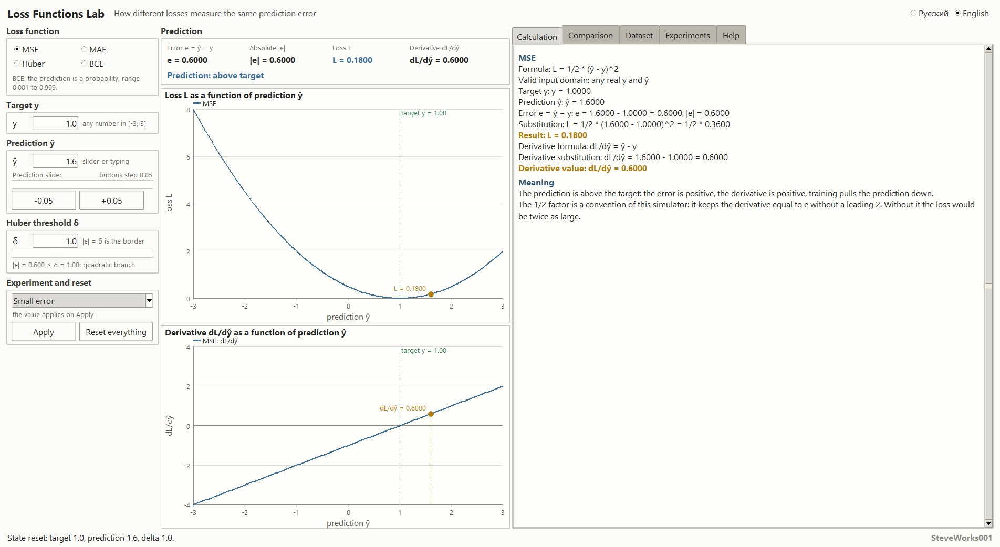
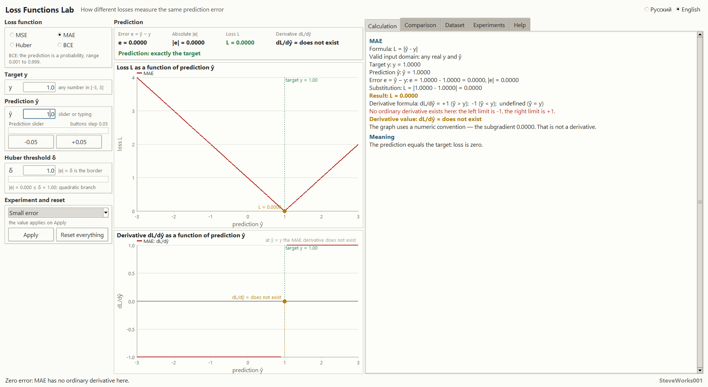
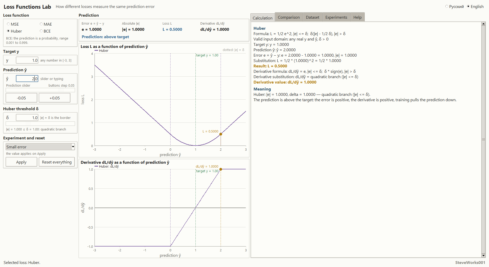
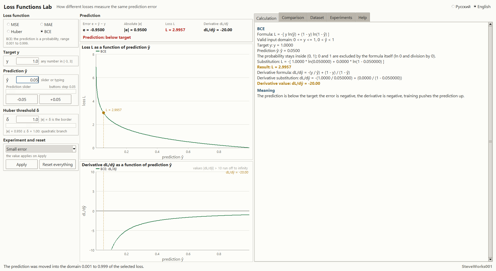
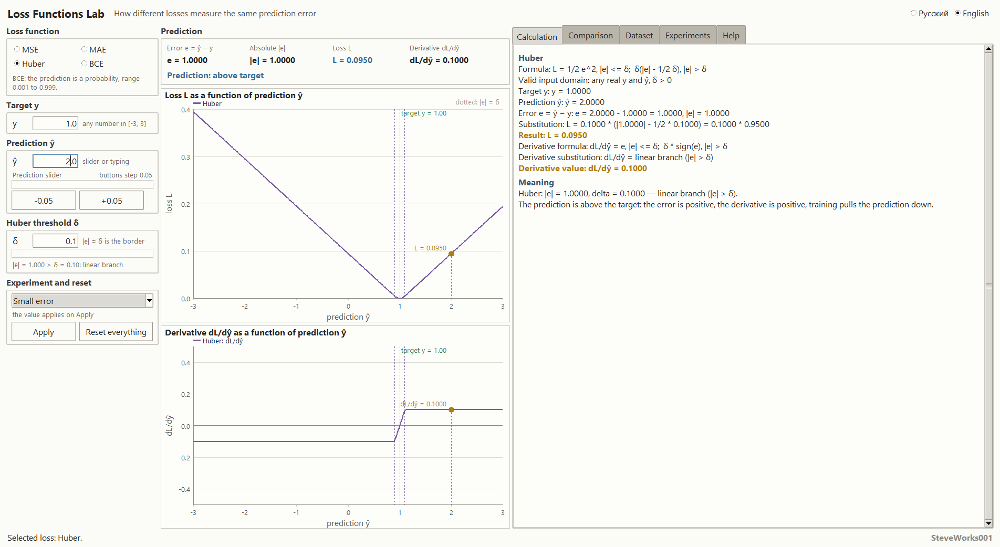
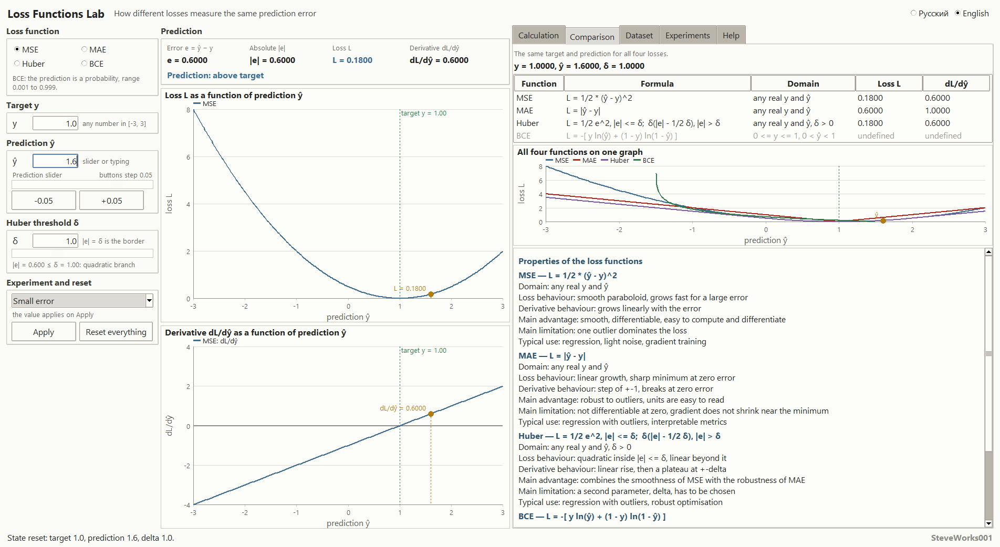
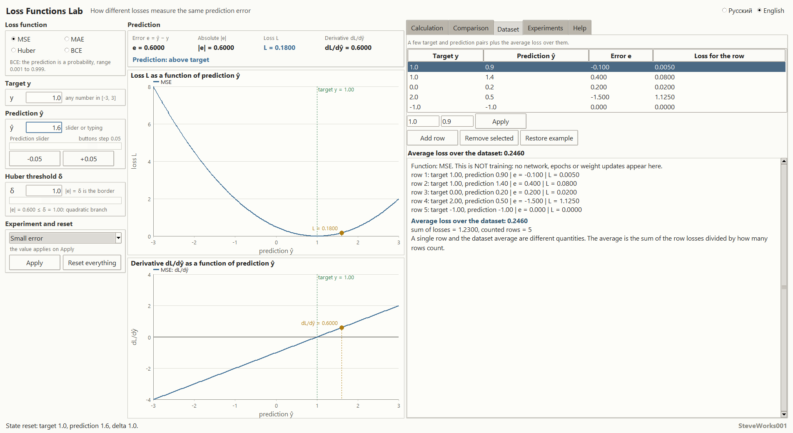
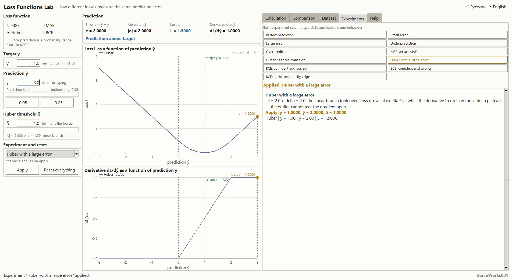
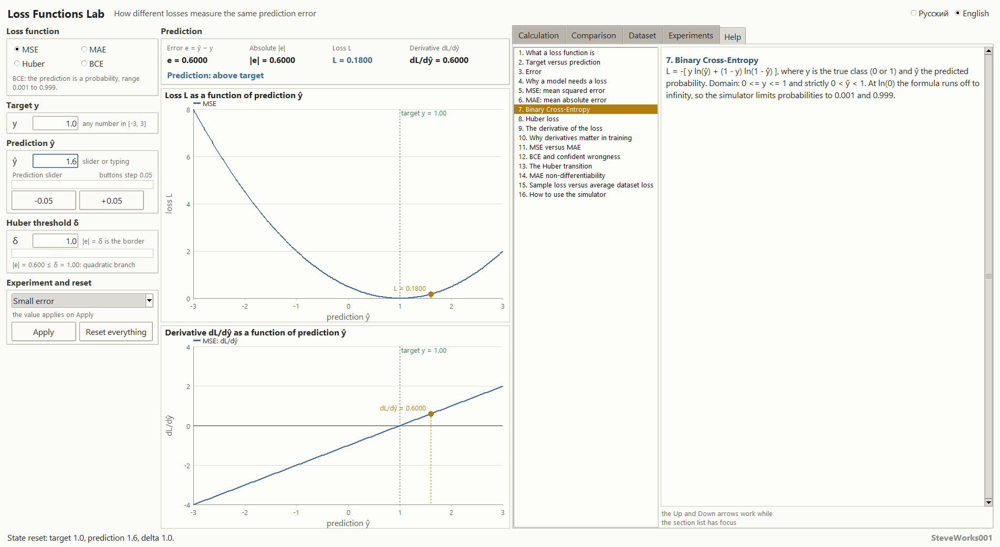

# Loss Functions Lab — an educational simulator

Project 8 of 13 in the educational neural-network simulator series.
A single-file Python and Tkinter application: standard library only, no external packages,
no network access and no dependency installation.
It is about the loss functions and their derivatives themselves — not a neural-network
training system.

Russian version: [README_RU.md](README_RU.md).

---

## Purpose

The simulator answers one question: **how do different loss functions penalize the very same
prediction error `e = ŷ − y`**. Change the target and the prediction and you see, in real time,
the loss value, the sign and size of the derivative, the direction training would move the
prediction, and how one and the same error produces completely different penalties under MSE,
MAE, Huber and BCE.

The whole interface is built around one chain:

**target `y` + prediction `ŷ` → error `e` → loss `L` → derivative `dL/dŷ`**

### What this project does not contain

The neighboring project in the series, Neural Network Training Lab, shows the complete
training cycle. Training is deliberately absent here:

- no epochs, no weights, no parameter updates;
- no backpropagation and no optimizer;
- no real model and no real training dataset;
- none of the production features of a machine-learning library.

All the attention goes to a single step: how a pair of numbers becomes a loss, and what its
derivative says.

## Learning goals

- Understand that a loss is a number, not a percentage and not the error itself: tell apart the
  error `e`, its absolute value `|e|` and the loss `L`.
- Understand why the derivative with respect to the prediction, `dL/dŷ`, is exactly the
  direction training moves the prediction.
- Compare how MSE, MAE, Huber and BCE penalize the same error.
- Feel the difference between a small and a large error: quadratic growth versus linear growth.
- Understand why MAE is not differentiable at zero error, and what a subgradient is.
- Understand how the threshold `δ` moves Huber between its quadratic and linear branches.
- Understand why BCE punishes confident wrong predictions disproportionately hard, and where
  it is defined at all.
- Tell a single sample's loss apart from the average loss over a dataset.

## Mathematics: the four loss functions

| Function | Loss formula | Derivative w.r.t. `ŷ` | Domain |
|---|---|---|---|
| **MSE** | `L = 1/2 · (ŷ − y)²` | `dL/dŷ = ŷ − y` | any `y`, `ŷ` |
| **MAE** | `L = \|ŷ − y\|` | `+1` when `ŷ > y`, `−1` when `ŷ < y`, **undefined** when `ŷ = y` | any `y`, `ŷ` |
| **BCE** | `L = −[ y·ln ŷ + (1−y)·ln(1−ŷ) ]` | `dL/dŷ = −y/ŷ + (1−y)/(1−ŷ)` | `0 ≤ y ≤ 1`, `0 < ŷ < 1` |
| **Huber** | `L = 1/2·e²` when `\|e\| ≤ δ`; `δ·(\|e\| − 1/2·δ)` when `\|e\| > δ` | `e` when `\|e\| ≤ δ`; `δ·sign(e)` when `\|e\| > δ` | any `y`, `ŷ`, `δ > 0` |

**MSE.** The `1/2` factor is a teaching convention: with it the derivative is exactly `ŷ − y`,
with no leading 2. Many libraries define the mean squared error as the mean of the squared
errors, that is without the `1/2` and divided by the number of samples — the same idea, a
different scale factor.

**MAE.** The derivative with respect to the prediction is `+1` when the prediction is above the
target and `−1` when it is below. At `ŷ = y` the ordinary derivative does not exist: the left
limit is `−1`, the right limit `+1`. The application says so plainly — "the derivative does not
exist". The value `0` at that exact point is used only to draw the graph, as one admissible
subgradient; it is a plotting convention, not a claim that the derivative exists.

**BCE.** Binary cross-entropy works with probabilities: the target `y` lies in `[0, 1]`, the
prediction `ŷ` lies strictly between `0` and `1`. The function becomes steeply expensive when a
confident prediction turns out to be wrong: `ŷ = 0.99` with `y = 0` is penalized far harder than
`ŷ = 0.6` with the same `y = 0`. The prediction control deliberately keeps the value slightly
away from the exact boundaries `0` and `1`, where the loss grows without bound.

**Huber.** Here `e = ŷ − y`. While `|e| ≤ δ` the loss is quadratic, as in MSE; once `|e| > δ` it
grows linearly, as in MAE, but with slope `δ`. The threshold `δ` *is* the transition point: a
small `δ` pulls the function toward MAE, a large one toward MSE. The default is `δ = 1.0`, and
you can set it anywhere in `0.1…3.0`.

**Sample loss and average loss.** One pair `(y, ŷ)` gives the loss of that single sample. With
several samples each one gets its own value, and the average loss over the dataset is the sum of
the applicable losses divided by their count. These are different quantities, and the dataset
mode shows both.

**Why the graph and the number can look different.** Both graphs have a drawing limit: `12` for
the loss curve and `10` for the derivative curve. A point beyond that limit is simply not drawn,
so the curve stops — which keeps the axis readable instead of flattening every other branch. The
numeric fields show the full value with no such limit: at `y = 1.0` and `ŷ = 0.001` the summary
prints `L = 6.9078` and `dL/dŷ = -1000.0`, while the derivative graph only shows the part up to
`±10`. That is a plotting limit, not a property of the function.

## Interface and usage

- **Left** — the loss selector (MSE / MAE / Huber / BCE), the target `y` field in the range
  `−3…3`, the prediction `ŷ` field and slider with step buttons `−0.05 / +0.05`, and the
  threshold `δ` for Huber. The ready-made experiments and the "Reset everything" button live
  here too.
- **Center** — the summary: error `e`, its absolute value, loss `L` and derivative `dL/dŷ`, plus
  two graphs stacked one above the other: the loss and the derivative as functions of the
  prediction. Each marks the vertical target line and the current prediction, and Huber draws
  the `|e| = δ` transition as a dashed line. On the derivative graph MAE shows a real gap at
  `ŷ = y` rather than a painted jump.
- **Right** — five tabs: Calculation, Comparison, Dataset, Experiments, Help.
- The Calculation tab derives the value step by step: formula → numbers → substitution →
  result → derivative formula → substitution → what the sign means. A final number never appears
  without its derivation.
- A typical session: pick a function → set the target → move the prediction → watch how the loss
  changes and where the derivative points → open Comparison to see the same error through the
  eyes of all four functions.
- The prediction can be dragged or typed — a decimal point, a comma and negative values are all
  accepted. Invalid input never crashes the app: the field is highlighted, a clear message is
  shown, and the last valid value is kept.

The interface is fully available in Russian and English and switches without restarting the
application; the current state — function, target, prediction, `δ`, dataset rows and selected
experiment — is preserved across a language switch.

## Comparison mode

The Comparison tab shows all four functions for the same `(y, ŷ)` pair:

- a table: function, formula, valid input domain, loss `L`, derivative `dL/dŷ`;
- a mini-graph of all four loss curves on one axis;
- a properties panel for the selected function: how the loss and the derivative behave, the main
  advantage, the main limitation, where it is used.

You can see how one and the same error turns into very different penalties: for large errors MSE
climbs quadratically, MAE grows linearly, Huber follows MSE first and then MAE, while BCE gives a
completely different scale because it works with probabilities. Where BCE does not apply (for
instance a prediction outside `(0, 1)`), the reason is shown instead of a number.

## Dataset mode

The Dataset tab is a small teaching set of `(target, prediction)` pairs: five rows by default,
never more than eight and never fewer than one. The "Add row", "Remove selected" and "Restore
example" buttons stay inside those bounds — the eighth row is the last one, and removing the
second-to-last leaves a single row; in both cases the status line says why. A new row appears as
`target 0.0, prediction 0.5`; the selected row can be edited, and both its target and its
prediction are clamped to `−3…3`.

**Dataset mode calculates the loss for individual samples and the average loss over the dataset.
It does not train a model.** There are no weight updates, no backpropagation and no optimization
here — only statistics over predictions that have already been made.

The point of the tab: a single sample's loss and the average dataset loss are different
quantities, and an average can hide both good and terrible predictions at the same time.

## Ready-made experiments

Eleven guided scenarios; each one changes the application state and explains one specific
behavior:

1. perfect prediction;
2. small error;
3. large error;
4. underestimation;
5. overestimation;
6. MSE versus MAE on the same error;
7. Huber near the transition;
8. Huber with a large error;
9. BCE: confident and correct;
10. BCE: confident and wrong;
11. BCE near the probability boundary.

The panel shows the explanation and the values the selected scenario will apply, right next to
the current state of the graph.

## Guided experiments

Every number below is exactly what the window prints in the state described. There is no
randomness and no training here: one function, two numbers, one result, so each experiment
reproduces to the last digit. The prediction buttons step by `0.05`, the target field takes
`−3…3`, the threshold `δ` takes `0.1…3.0`.

**1. One error, four different penalties.** Start the application, change nothing (MSE,
`y = 1.0`, `ŷ = 1.6` are the defaults) and open the Comparison tab.
Observe: the error is `e = 0.6000`. MSE gives `L = 0.1800` and `dL/dŷ = 0.6000`; MAE gives
`L = 0.6000` and `dL/dŷ = 1.0000`; Huber at `δ = 1.0` prints exactly the MSE numbers, because
`|e| = 0.6 ≤ δ`; for BCE both numeric columns read "undefined", since `ŷ = 1.6` lies outside
`(0, 1)`.
Think about: the same error has been named by four different numbers. What does "a loss of 0.6"
mean without the name of the function, and why does comparing two models by "average loss" only
make sense when both use the same loss?

**2. The sign gives direction, the size gives step length.** In the "Ready-made experiment" list
on the left choose "Underprediction" and press "Apply", then do the same for "Overprediction".
Observe: `ŷ = -0.5` against `y = 1.0` gives `L = 1.1250`, `dL/dŷ = -1.5000` and the caption
"Prediction: below target"; `ŷ = 2.5` gives exactly the same `L = 1.1250` and `|e| = 1.5000`, but
`dL/dŷ = 1.5000` and "above target". After "Apply" the app switches to the Experiments tab and
prints the explanation of the chosen scenario.
Think about: training moves against the sign of the derivative, so in both cases it heads toward
the target. What can gradient descent choose between two errors of different size that cost the
same, and what can it never choose?

**3. The threshold `δ` switches the Huber branches.** Set `y = 1.0` and `ŷ = 3.0` (so `|e| = 2.0`)
and walk `δ` from `0.1` to `3.0`.
Observe: `δ = 0.1` → `L = 0.1950`, `dL/dŷ = 0.1000`; `δ = 1.0` → `1.5000` and `1.0000`; `δ = 2.0`
→ `2.0000` and `2.0000`; `δ = 3.0` → the same `2.0000` and `2.0000`, that is Huber has become
MSE. The caption under the threshold field switches between "quadratic branch" and "linear
branch", and both graphs draw a dotted line at `|e| = δ`.
Think about: why exactly on the border (`δ = |e|`) the app still counts it as the quadratic
branch, and what happens to the size of a training step once the derivative freezes at `±δ` and
stops growing with the error.

**4. BCE accepts a fractional target.** Select BCE, set `y = 0.5` and `ŷ = 0.9`, then `ŷ = 0.5`,
then keep `ŷ = 0.5` and set `y = 2.0`.
Observe: at `y = 0.5, ŷ = 0.9` the loss is `L = 1.2040` and `dL/dŷ = 4.4444`; at `ŷ = 0.5` it is
`L = 0.6931` (that is `ln 2`) and `dL/dŷ = 0.0000`, so the derivative is exactly zero while the
loss is not zero; at `y = 2.0` the summary prints "undefined" in both lines, the status
line points at the Calculation tab, and that tab names the whole condition: `0 ≤ y ≤ 1`,
`0 < ŷ < 1`.
Think about: why the minimum of BCE sits at `ŷ = y` rather than at `L = 0`, and when a target of
`0.5` is useful in a real setup (soft labels, label smoothing).

**5. One bad row in the dataset.** On the Dataset tab with MSE selected, note the "Average loss
over the dataset" line and the "sum of losses = …, counted rows = …" line, then highlight the
fourth row of the table (`target 2.0, prediction 0.5`) and press "Remove selected".
Observe: before removing, the average is `0.2460` over a sum of `1.2300` and five counted rows;
after it, `0.0262` over a sum of `0.1050` and four counted rows — one failing row
inflated the average by
almost nine times. Press "Restore example" and switch the function to BCE: the average is
`0.1643`, the sum `0.3285`, only 2 of the 5 rows are counted, and the panel adds its own note
that BCE only counts rows with `0 ≤ y ≤ 1` and `0 < ŷ < 1`.
Think about: the dataset average is the average over the *applicable* rows, not a "typical
sample"; what does `0.1643` hide, and why is it not comparable with `0.2460` from the same rows.

## Installation and launch

The application is a single file; there is nothing to build or install.

Windows:

```bash
python loss_functions_lab.py
```

macOS and Linux:

```bash
python3 loss_functions_lab.py
```

No command-line arguments, and it can be started from any folder — the application reads no
external files. Quick start: at launch MSE, target `1.0`, prediction `1.6` and `δ = 1.0` are
selected — move the prediction with the `±0.05` buttons, then open Comparison and look at the
same numbers through the eyes of all four functions.

The window opens maximized and is intended for a typical desktop: the minimum size is about
`1300×768` (on a smaller screen the lower bound shrinks with the screen), the starting size
roughly 92 % of the screen width and 90 % of its height. Some
window managers refuse programmatic maximization, and then the window has to be maximized by
hand; very narrow windows make the interface harder to read.

## Screenshots

The frames come from the running application; the captured client area of the
window is 1904x1042 pixels. The starting window size is about 92 % of the screen
width and 90 % of its height, so on another monitor the window opens at a
different size: the scale of the frame changes, its content does not.

**Main screen: the Calculation tab, MSE selected, target `1.0`, prediction `1.6`**



**MAE at zero error: the derivative is reported as "does not exist"**



**Huber at `δ = 1.0` and `|e| = 1.0`: exactly the boundary between the branches**



**BCE and a confident mistake: target `1.0`, prediction `0.05` → `L = 2.9957`, `dL/dŷ = -20.00`**



**Huber with a small threshold `δ = 0.1`: the linear branch, the derivative frozen at `0.1`**



**Comparison tab: the table of four losses and one shared graph**



**Dataset tab: five sample rows and an average loss of `0.2460`**



**Experiments tab: the "Huber with a large error" experiment applied**



**Invalid input: the field is marked, the previous value is kept**


**Help tab: the list of 16 sections with section 7 open**



## Requirements

- Python 3.8 or newer.
- Tkinter — included in the official Python builds for Windows and macOS; on some Linux
  distributions it is installed separately as the `python3-tk` package.
- Standard library only: `math`, `tkinter`, `tkinter.font`, `tkinter.ttk`.
- Not used: NumPy, pandas, SciPy, matplotlib or external GUI frameworks.
- No network connection is required to run the application.

## Limitations

- The application does **not** train models: no epochs, weights, backpropagation or optimizer.
- One active `(y, ŷ)` pair on the main screen; the dataset is a small teaching sample, not a full
  dataset builder.
- BCE is defined for `0 ≤ y ≤ 1` and `0 < ŷ < 1`, and the target does not have to be exactly 0
  or 1: `y = 0.5` is calculated just as honestly. The target field allows `−3…3`, so for a target
  outside `[0, 1]` the app shows "undefined" and names the condition — that is intended behaviour,
  not a bug. The multiclass variant is not implemented.
- MAE has no derivative at `ŷ = y`; the subgradient `0` is used for the graph as an explicit
  convention.
- The target range is fixed (`−3…3`) — enough to show the teaching shapes of the curves.
- At very narrow window widths (around `1300 px` and below) some long values in the comparison
  table may be ellipsized, which keeps the table readable and preserves the size of the graphs.

## Educational note

The simulator exists to build an understanding of how loss functions and their derivatives
behave. Some numerical conventions are chosen for educational clarity and may differ from the
exact definition used by a particular machine-learning library — the `1/2` factor in the MSE
formula, for instance. Before using a loss in a real model, check its definition in your library.

## What to know beforehand

**Strictly required:** Python 3 with Tkinter and launching one file from the command line. No
`pip` packages, no network, no external files.

**Mathematics:** the derivative as the answer to "which way should the prediction move for the
loss to go down", and reading short expressions such as `½(ŷ − y)²` and `|ŷ − y|`. Of the four
functions only BCE needs a logarithm, and even that never has to be computed by hand: `dL/dŷ` is
printed as its own line with the numbers substituted, and the Calculation tab shows the
substitution itself. Nothing has to be differentiated manually.

**Useful but not required:** project 4 "Gradient Descent" — there the derivative becomes an actual
step scaled by `η`; project 7 "Activation Functions" — `ŷ` is an activation output, and the
sigmoid is exactly what produces the `(0, 1)` range BCE lives in; project 6 "Neural Network
Training" — there the loss is fixed as `½(ŷ − y)²` and wired into a training loop, while here it
is one of four functions you pick.

**About the Python version:** the Requirements section names Python 3.8 or newer. The application
does not check the version, and launching it under other versions was not tested — that is
declared compatibility, not a verified guarantee.

## Place in the series

Project 8 of 13. The order is not strict: every project runs on its own and reads nothing from
its neighbours. Only connections that exist by subject matter are listed below.

| Project | Connection by subject |
|---|---|
| 4 — Gradient Descent | there `−η · L'` turns the derivative into a step; here the derivative's sign and size are examined |
| 5 — Backpropagation | the `dL/dŷ` from here is the first factor of the chain rule, where the backward pass begins |
| 6 — Neural Network Training | there the loss is fixed as `½(ŷ − y)²`; here it is one of four and you choose it |
| 7 — Activation Functions | `ŷ` is an activation output; the sigmoid gives exactly the `(0, 1)` where BCE is defined |
| 9 — Classification | here BCE only computes the penalty; there that penalty and the 0.5 threshold become quality metrics |
| 10 — Overfitting | training MSE and test MSE are the same loss averaged over two different samples |
| 13 — Multiclass Softmax | here BCE handles one binary target; there cross-entropy is taken over several classes |

## Developer

**Developer: SteveWorks001**

## License

This project is released under the MIT license; the full text is in the file
[LICENSE](LICENSE).
