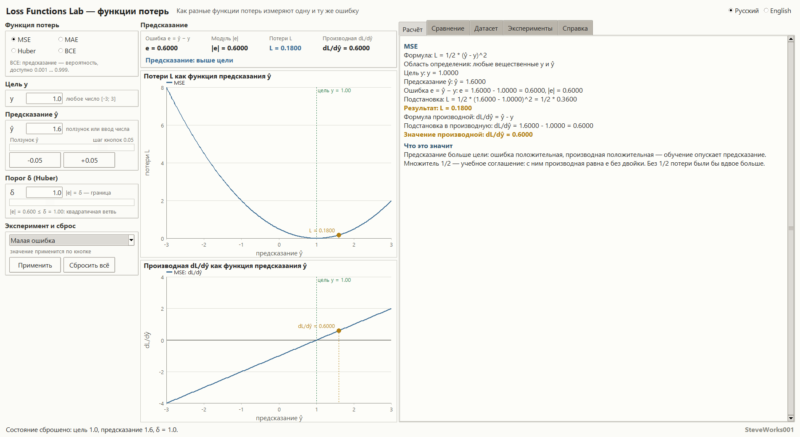
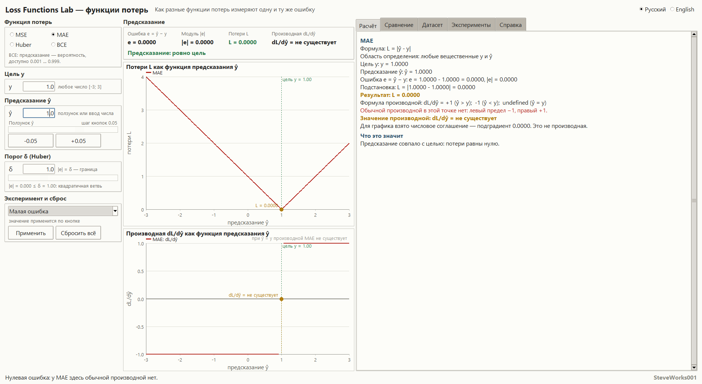
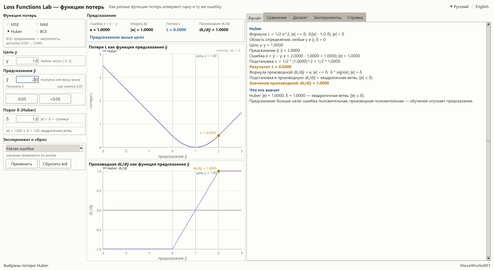
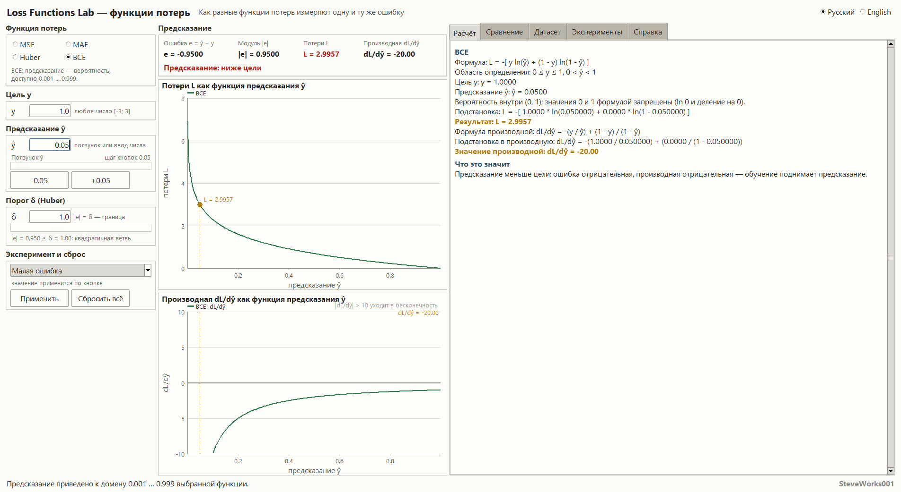
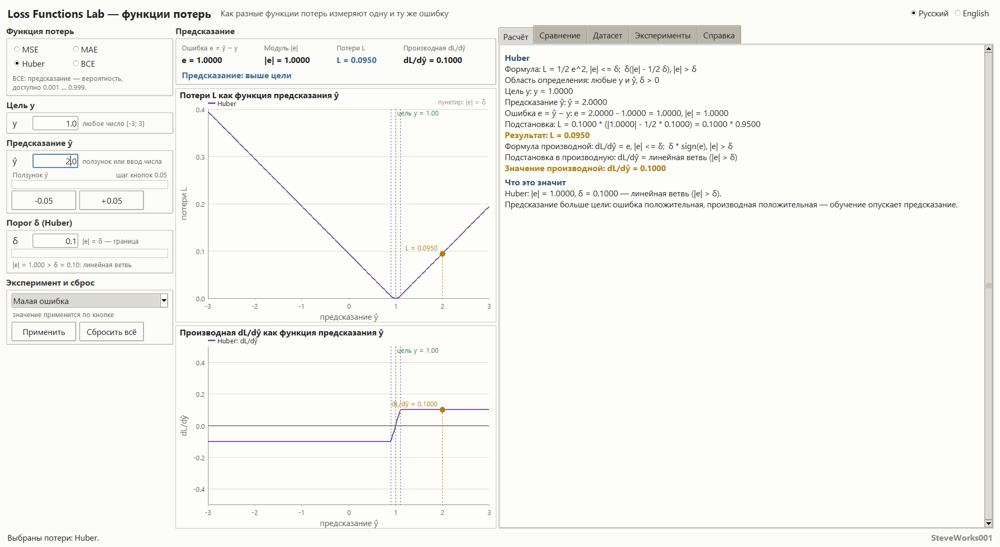
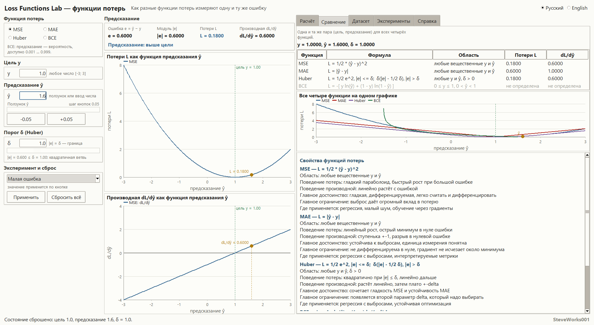
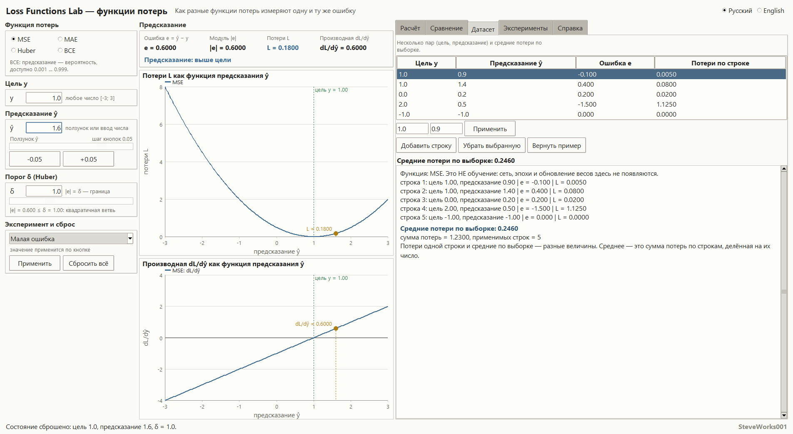
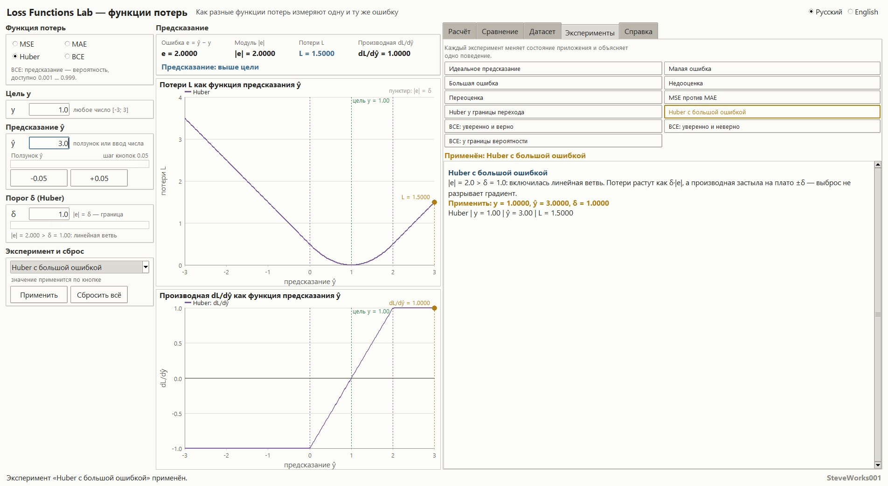
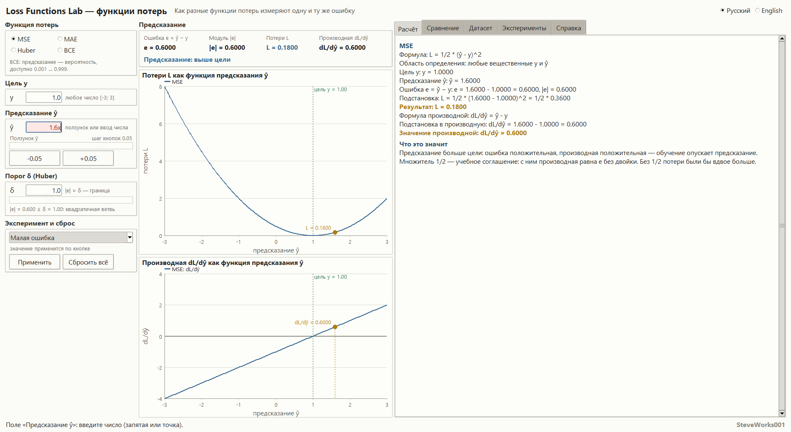
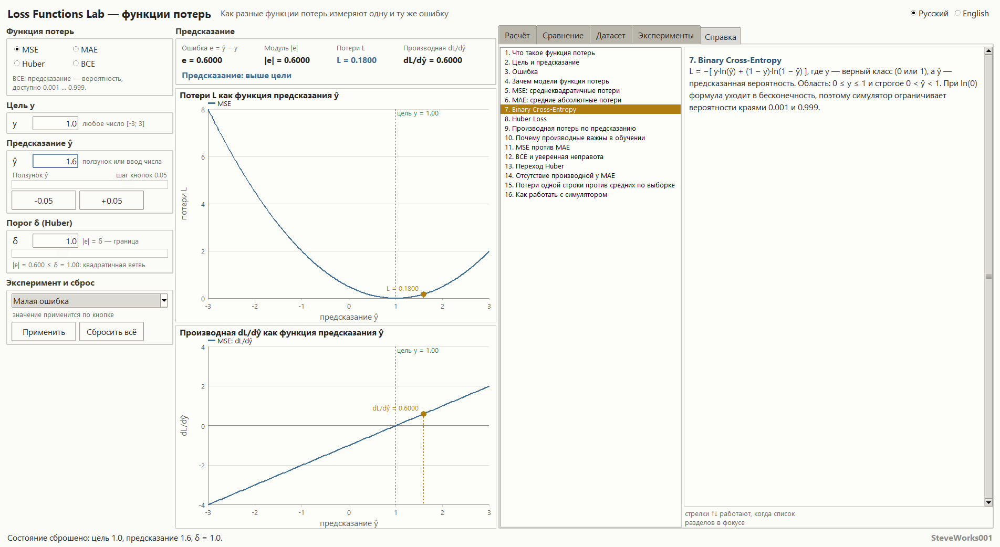

# Loss Functions Lab — учебный симулятор функций потерь

Проект 8 из 13 серии учебных симуляторов нейронных сетей.
Однофайловое приложение на Python и Tkinter: только стандартная библиотека,
без внешних пакетов, без сети и без установки зависимостей.
Разбираются сами функции потерь и их производные — это не система обучения нейросетей.

Текст на английском: [README_EN.md](README_EN.md).

---

## Назначение

Симулятор отвечает на один вопрос: **чем разные функции потерь штрафуют одну и ту же
ошибку предсказания `e = ŷ − y`**. Меняя цель и предсказание, вы в реальном времени видите
число потерь, знак и величину производной, направление, куда обучение сдвинуло бы
предсказание, и то, как одна и та же ошибка даёт совсем разные штрафы у MSE, MAE, Huber и BCE.

Основная цепочка, на которой построен весь интерфейс:

**цель `y` + предсказание `ŷ` → ошибка `e` → потери `L` → производная `dL/dŷ`**

### Чего в этом проекте нет

Соседний проект серии, Neural Network Training Lab, показывает полный цикл обучения.
Здесь обучения нет намеренно:

- нет эпох, весов и обновлений параметров;
- нет обратного распространения ошибки и оптимизатора;
- нет реальной модели и настоящей учебной выборки;
- нет производственных возможностей библиотек машинного обучения.

Всё внимание — одному шагу: как из пары чисел получаются потери и что говорит их производная.

## Учебные цели

- Понять, что потери — это число, а не «процент» и не сама ошибка: отличить ошибку `e`,
  её модуль `|e|` и значение потерь `L`.
- Понять, почему производная по предсказанию `dL/dŷ` задаёт направление, куда обучение
  сдвигает предсказание.
- Сравнить, как MSE, MAE, Huber и BCE штрафуют одну и ту же ошибку.
- Почувствовать разницу между малой и большой ошибкой: квадратичный рост против линейного.
- Понять, почему MAE не дифференцируема при нулевой ошибке и что такое субградиент.
- Понять, как порог `δ` переводит Huber из квадратичной ветви в линейную.
- Понять, почему BCE наказывает уверенные неверные предсказания непропорционально сильно
  и где она вообще применима.
- Различать потери одного примера и средние потери по выборке.

## Математика: четыре функции потерь

| Функция | Формула потерь | Производная по `ŷ` | Область |
|---|---|---|---|
| **MSE** | `L = 1/2 · (ŷ − y)²` | `dL/dŷ = ŷ − y` | любые `y`, `ŷ` |
| **MAE** | `L = \|ŷ − y\|` | `+1` при `ŷ > y`, `−1` при `ŷ < y`, **не существует** при `ŷ = y` | любые `y`, `ŷ` |
| **BCE** | `L = −[ y·ln ŷ + (1−y)·ln(1−ŷ) ]` | `dL/dŷ = −y/ŷ + (1−y)/(1−ŷ)` | `0 ≤ y ≤ 1`, `0 < ŷ < 1` |
| **Huber** | `L = 1/2·e²` при `\|e\| ≤ δ`; `δ·(\|e\| − 1/2·δ)` при `\|e\| > δ` | `e` при `\|e\| ≤ δ`; `δ·sign(e)` при `\|e\| > δ` | любые `y`, `ŷ`, `δ > 0` |

**MSE.** Множитель `1/2` — учебное соглашение: с ним производная равна ровно `ŷ − y`, без
двойки впереди. Многие библиотеки определяют среднеквадратичную ошибку как среднее квадратов
ошибок, то есть без `1/2` и с делением на число примеров; это та же по смыслу функция, но с
другим множителем.

**MAE.** Производная по предсказанию равна `+1`, когда предсказание больше цели, и `−1`,
когда меньше. При `ŷ = y` обычная производная не существует: левый предел `−1`, правый `+1`.
Приложение так и пишет — «производная не существует». Значение `0` в этой точке используется
только для построения графика как одно из допустимых значений субградиента; это соглашение
отрисовки, а не утверждение о существовании производной.

**BCE.** Бинарная перекрёстная энтропия работает с вероятностью: цель `y` лежит в отрезке
`[0, 1]`, предсказание `ŷ` — строго между `0` и `1`. Функция резко дорожает, когда уверенное
предсказание оказывается неверным: `ŷ = 0.99` при `y = 0` наказывается намного сильнее, чем
`ŷ = 0.6` при том же `y = 0`. Управление предсказанием сознательно не подпускает значение к
самим границам `0` и `1`, где потери уходят в бесконечность.

**Huber.** Здесь `e = ŷ − y`. Пока `|e| ≤ δ`, потери квадратичные — как у MSE; когда
`|e| > δ`, они растут линейно — как у MAE, только с наклоном `δ`. Порог `δ` и есть точка
перехода: маленький `δ` делает функцию ближе к MAE, большой — к MSE. По умолчанию `δ = 1.0`,
управлять им можно в диапазоне `0.1…3.0`.

**Потери одного примера и средние потери.** Одна пара `(y, ŷ)` даёт потери конкретного
примера. Если примеров несколько, для каждого считается своё значение, а средние потери по
выборке — это сумма применимых потерь, делённая на их число. Это разные величины, и в режиме
датасета показаны обе.

**Почему график и число могут выглядеть по-разному.** У обоих графиков есть предел
отрисовки: `12` для кривой потерь и `10` для кривой производной. Точка за этим пределом просто
не рисуется — кривая обрывается, зато ось остаётся читаемой и соседние ветви не сливаются в
плоскость. Числовые поля показывают полное значение без всякого ограничения: при `y = 1.0` и
`ŷ = 0.001` сводка печатает `L = 6.9078` и `dL/dŷ = -1000.0`, хотя на графике производной видно
только участок до `±10`. Это ограничение рисовки, а не свойства функции.

## Интерфейс и как пользоваться

- **Слева** — выбор функции потерь (MSE / MAE / Huber / BCE), поле цели `y` в диапазоне
  `−3…3`, поле и ползунок предсказания `ŷ` с кнопками шага `−0.05 / +0.05`, а для Huber —
  порог `δ`. Там же готовые эксперименты и кнопка «Сбросить всё».
- **В центре** — сводка: ошибка `e`, её модуль, потери `L` и производная `dL/dŷ`, и два
  графика один под другим: потери и производная как функции предсказания. На каждом отмечены
  вертикальная линия цели и текущее предсказание, а у Huber пунктиром показан переход
  `|e| = δ`. У MAE на графике производной в точке `ŷ = y` виден настоящий разрыв, а не
  нарисованный «прыжок».
- **Справа** — пять вкладок: «Расчёт», «Сравнение», «Датасет», «Эксперименты», «Справка».
- На вкладке «Расчёт» значение выводится по шагам: формула → числа → подстановка → результат →
  формула производной → подстановка → смысл знака. Финальное число никогда не появляется
  без вывода.
- Обычная последовательность: выбрать функцию → задать цель → двигать предсказание → смотреть,
  как меняются потери и куда указывает производная → открыть «Сравнение», чтобы увидеть ту же
  ошибку глазами всех четырёх функций.
- Предсказание можно и двигать ползунком, и вводить с клавиатуры — принимаются точка, запятая
  и отрицательные значения. Некорректный ввод приложение не роняет: поле подсвечивается,
  показывается понятное сообщение, а предыдущее допустимое значение сохраняется.

Интерфейс полностью доступен на русском и английском и переключается без перезапуска; текущее
состояние — функция, цель, предсказание, `δ`, строки датасета и выбранный эксперимент — при
переключении сохраняется.

## Режим сравнения

Вкладка «Сравнение» показывает все четыре функции для одной и той же пары `(y, ŷ)`:

- таблица: функция, формула, область определения, потери `L`, производная `dL/dŷ`;
- мини-график всех четырёх кривых потерь на одной оси;
- панель свойств выбранной функции: как ведут себя потери и производная, главное достоинство,
  главное ограничение, где применяется.

Видно, как одна и та же ошибка по-разному превращается в штраф: при больших ошибках MSE уходит
вверх квадратично, MAE растёт линейно, Huber сначала следует за MSE, а затем — за MAE, а BCE
даёт совершенно иную шкалу, потому что работает с вероятностями. Там, где BCE неприменима
(например, предсказание вне `(0, 1)`), вместо числа показывается причина.

## Режим датасета

Вкладка «Датасет» — небольшая учебная подборка пар «цель, предсказание»: пять строк по
умолчанию, не больше восьми и не меньше одной. Кнопки «Добавить строку», «Убрать выбранную» и
«Вернуть пример» работают внутри этих границ: восьмая строка последняя, а удаление предпоследней
оставит одну, и в обоих случаях приложение пишет причину в строку состояния. Новая строка
появляется как `цель 0.0, предсказание 0.5`; выбранную строку можно редактировать, и цель, и
предсказание при редактировании приводятся к `−3…3`.

**Режим датасета считает потери для отдельных примеров и средние потери по выборке.
Он не обучает модель.** Никаких обновлений весов, обратного распространения и оптимизации здесь
нет — это только статистика по уже сделанным предсказаниям.

Главный вывод, ради которого сделана вкладка: потери одного примера и средние потери по выборке
— разные величины, и среднее число может одновременно скрывать удачные и провальные
предсказания.

## Готовые эксперименты

Одиннадцать настраиваемых сценариев, каждый меняет состояние приложения и объясняет одно
конкретное поведение:

1. идеальное предсказание;
2. малая ошибка;
3. большая ошибка;
4. недооценка;
5. переоценка;
6. MSE против MAE на одной и той же ошибке;
7. Huber у границы перехода;
8. Huber с большой ошибкой;
9. BCE: уверенно и верно;
10. BCE: уверенно и неверно;
11. BCE у границы вероятности.

Панель показывает пояснение и те значения, которые применит выбранный сценарий, рядом с
текущим состоянием графика.

## Учебные опыты

Все числа ниже — ровно то, что печатает окно приложения в названном состоянии. Случайности и
обучения здесь нет: одна функция, одна пара чисел, один результат, поэтому опыт воспроизводится до
последнего знака. Шаг кнопок предсказания — `0.05`, поле цели принимает `−3…3`, порог `δ` —
`0.1…3.0`.

**1. Одна ошибка — четыре разных штрафа.** Запустите приложение, ничего не меняйте (по
умолчанию выбраны MSE, `y = 1.0`, `ŷ = 1.6`) и откройте вкладку «Сравнение».
Наблюдайте: ошибка `e = 0.6000`. MSE даёт `L = 0.1800` и `dL/dŷ = 0.6000`; MAE — `L = 0.6000` и
`dL/dŷ = 1.0000`; Huber при `δ = 1.0` печатает те же числа, что и MSE, потому что `|e| = 0.6 ≤ δ`;
у BCE обе числовые колонки — «не определена», так как `ŷ = 1.6` лежит вне `(0, 1)`.
О чём подумать: одна и та же ошибка названа четырьмя числами. Что значит фраза «потеря 0.6» без
имени функции и почему сравнение двух моделей по «средней потере» имеет смысл только при
зафиксированной одной и той же функции?

**2. Знак задаёт направление, величина — размер.** В списке «Готовый эксперимент» слева выберите
«Недооценка» и нажмите «Применить», затем то же самое для «Переоценка».
Наблюдайте: при `ŷ = -0.5` и `y = 1.0` получается `L = 1.1250`, `dL/dŷ = -1.5000` и подпись
«Предсказание: ниже цели»; при `ŷ = 2.5` — ровно те же `L = 1.1250` и `|e| = 1.5000`, но
`dL/dŷ = 1.5000` и подпись «выше цели». После «Применить» приложение само открывает вкладку
«Эксперименты» с пояснением выбранного сценария.
О чём подумать: обучение идёт против знака производной, то есть в обоих случаях — к цели. Если
две ошибки разного размера дают одинаковые потери, что градиентный спуск может выбрать, а что —
никогда?

**3. Порог `δ` переключает ветви Huber.** Поставьте `y = 1.0`, `ŷ = 3.0` (то есть `|e| = 2.0`) и
пройдите `δ` от `0.1` до `3.0`.
Наблюдайте: `δ = 0.1` → `L = 0.1950`, `dL/dŷ = 0.1000`; `δ = 1.0` → `1.5000` и `1.0000`;
`δ = 2.0` → `2.0000` и `2.0000`; `δ = 3.0` → те же `2.0000` и `2.0000`, то есть Huber совпал с
MSE. Подпись под полем порога переключается между «квадратичная ветвь» и «линейная ветвь», а на
обоих графиках пунктир отмечает `|e| = δ`.
О чём подумать: почему ровно на границе (`δ = |e|`) приложение считает это ещё квадратичной
ветвью; что происходит с размером шага обучения, когда производная замирает на `±δ` и больше не
растёт вместе с ошибкой.

**4. BCE принимает дробную цель.** Выберите BCE, поставьте `y = 0.5` и `ŷ = 0.9`, затем `ŷ = 0.5`,
затем, не меняя предсказания, поставьте `y = 2.0`.
Наблюдайте: при `y = 0.5, ŷ = 0.9` — `L = 1.2040` и `dL/dŷ = 4.4444`; при `ŷ = 0.5` — `L = 0.6931`
(это `ln 2`) и `dL/dŷ = 0.0000`, то есть производная ровно нулевая, а потери ненулевые;
при `y = 2.0` сводка печатает «не определена» в обеих строках, статусная строка отсылает во
вкладку «Расчёт», а там названо условие целиком: `0 ≤ y ≤ 1`, `0 < ŷ < 1`.
О чём подумать: почему минимум BCE лежит при `ŷ = y`, а не при `L = 0`, и зачем нужна цель `0.5`
в реальной постановке (мягкие метки, сглаживание меток).

**5. Одна плохая строка в датасете.** На вкладке «Датасет» при выбранной MSE запомните строку
«Средние потери по выборке» и строку «сумма потерь = …, применимых строк = …», затем выделите
в таблице четвёртую строку (`цель 2.0, предсказание 0.5`) и нажмите «Убрать выбранную».
Наблюдайте: до удаления — среднее `0.2460` при сумме `1.2300` и пяти применимых строках; после —
среднее `0.0262` при сумме `0.1050` и четырёх применимых строках: одна провальная строка
завышала среднее почти в девять раз. Нажмите «Вернуть пример» и переключите функцию
на BCE: среднее `0.1643`, сумма
`0.3285`, применимых строк 2 из 5, и в панели появляется отдельная заметка о том, что BCE
считает только строки с `0 ≤ y ≤ 1` и `0 < ŷ < 1`.
О чём подумать: среднее по выборке — это среднее по «применимым» строкам, а не «типичный
пример»; что скрывает число `0.1643` и почему его нельзя сравнивать с `0.2460` из того же набора
строк.

## Установка и запуск

Приложение — один файл; сборки и установки зависимостей не требуется.

Windows:

```bash
python loss_functions_lab.py
```

macOS и Linux:

```bash
python3 loss_functions_lab.py
```

Аргументы командной строки не нужны, запускать можно из любой папки — внешних
файлов приложение не читает. Быстрый старт: при запуске выбраны MSE, цель `1.0`,
предсказание `1.6` и `δ = 1.0` — подвигайте предсказание кнопками `±0.05`, а затем
откройте «Сравнение» и посмотрите на те же числа глазами всех четырёх функций.

Окно открывается развёрнутым и рассчитано на типичный десктоп: минимальный размер
примерно `1300×768` (на более мелком экране нижняя граница автоматически меньше),
стартовый — около 92 % ширины и 90 % высоты экрана. Некоторые
оконные менеджеры отказывают в программной развёртке, и тогда окно приходится
разворачивать вручную; очень узкие окна ухудшают читаемость интерфейса.

## Скриншоты

Снимки сделаны из работающего приложения; захвачена клиентская область окна
1904×1042 пикселя. Стартовый размер окна — около 92 % ширины и 90 % высоты
экрана, поэтому на другом мониторе окно откроется другого размера: изменится
масштаб кадра, но не его содержимое.

**Главный экран: вкладка «Расчёт», выбрана MSE, цель `1.0`, предсказание `1.6`**



**MAE при нулевой ошибке: производная показана как «не существует»**



**Huber при `δ = 1.0` и `|e| = 1.0`: ровно граница между ветвями**



**BCE и уверенная неправота: цель `1.0`, предсказание `0.05` → `L = 2.9957`, `dL/dŷ = -20.00`**



**Huber с малым порогом `δ = 0.1`: работает линейная ветвь, производная застыла на `0.1`**



**Вкладка «Сравнение»: таблица четырёх функций и общий график**



**Вкладка «Датасет»: пять строк выборки и средние потери `0.2460`**



**Вкладка «Эксперименты»: применён опыт «Huber с большой ошибкой»**



**Некорректный ввод: поле подсвечено, прежнее значение сохранено**



**Вкладка «Справка»: список из 16 разделов и открытый раздел 7**



## Требования

- Python 3.8 или новее.
- Tkinter — входит в официальные сборки Python для Windows и macOS; в некоторых дистрибутивах
  Linux ставится отдельно как пакет `python3-tk`.
- Только стандартная библиотека: `math`, `tkinter`, `tkinter.font`, `tkinter.ttk`.
- Не используются: NumPy, pandas, SciPy, matplotlib и сторонние GUI-фреймворки.
- Сетевое соединение для работы приложения не требуется.

## Ограничения

- Приложение **не обучает** модели: нет эпох, весов, обратного распространения и оптимизатора.
- На основном экране активна одна пара `(y, ŷ)`; датасет — небольшой учебный набор, а не
  полноценный конструктор выборок.
- BCE определена при `0 ≤ y ≤ 1` и `0 < ŷ < 1`, причём цель не обязана быть нулём или
  единицей: `y = 0.5` считается так же честно. Поле цели позволяет `−3…3`, поэтому при `y` вне
  `[0, 1]` приложение показывает «не определена» и называет условие — это нормальное поведение,
  а не ошибка. Многоклассовый вариант не реализован.
- У MAE при `ŷ = y` производной нет; для графика используется субградиент `0` как явное
  соглашение.
- Диапазон цели фиксирован (`−3…3`) — этого достаточно для учебных форм кривых.
- При очень узком окне (примерно `1300 px` и меньше) длинные значения в таблице сравнения могут
  скрываться за многоточием: так сохраняются читаемость таблицы и размер графиков.

## Учебная оговорка

Симулятор предназначен для понимания поведения функций потерь и их производных. Отдельные
численные соглашения выбраны ради наглядности и могут отличаться от определений, принятых в
конкретной библиотеке машинного обучения, — например множитель `1/2` в формуле MSE. Перед
использованием в реальной модели сверяйтесь с определением функции потерь в вашей библиотеке.

## Что нужно знать заранее

**Строго необходимо:** Python 3 с Tkinter и запуск одного файла из командной строки. Пакеты из
`pip`, сеть и внешние файлы не нужны.

**Математика:** производная как ответ на вопрос «в какую сторону менять предсказание, чтобы
потери уменьшались», и умение читать короткие выражения вида `½(ŷ − y)²` и `|ŷ − y|`. Из всех
четырёх функций только BCE требует логарифма — и то считать его не придётся: `dL/dŷ` для каждой
функции приложение печатает отдельной строкой с уже подставленными числами, а вкладка «Расчёт»
показывает ещё и саму подстановку. Дифференцировать вручную ничего не нужно.

**Полезно, но не обязательно:** проект 4 «Градиентный спуск» — там производная превращается в
конкретный шаг с множителем `η`; проект 7 «Activation Functions» — `ŷ` есть выход активации, и
именно сигмоида даёт те самые `(0, 1)`, в которых определена BCE; проект 6 «Neural Network
Training» — там потеря зафиксирована как `½(ŷ − y)²` и встроена в цикл обучения, а здесь она
одна из четырёх на выбор.

**О версии Python:** раздел «Требования» называет Python 3.8 или новее. Приложение версию не
проверяет, а запуск на других версиях не тестировался — это объявленная совместимость, а не
проверенная гарантия.

## Место в серии

Проект 8 из 13. Порядок не строгий: каждый проект запускается сам по себе и ничего не читает из
соседних. Ниже только те связи, которые есть по содержанию.

| Проект | Связь по содержанию |
|---|---|
| 4 — Gradient Descent | там `−η · L'` превращает производную в шаг; здесь у неё ищут знак и величину |
| 5 — Backpropagation | `dL/dŷ` отсюда — первый множитель цепочки правил, с которого начинается обратный ход |
| 6 — Neural Network Training | там потеря зафиксирована как `½(ŷ − y)²`; здесь она одна из четырёх и её можно выбрать |
| 7 — Activation Functions | `ŷ` — выход активации; сигмоида как раз даёт то `(0, 1)`, где определена BCE |
| 9 — Classification | здесь BCE только считает штраф; там этот штраф и порог 0.5 превращаются в метрики качества |
| 10 — Overfitting | MSE обучения и MSE теста — одни и те же потери, усреднённые по разным выборкам |
| 13 — Multiclass Softmax | здесь BCE определена для одной бинарной цели; там кросс-энтропия считается по нескольким классам |

## Разработчик

**Разработчик: SteveWorks001**

## Лицензия

Проект распространяется под лицензией MIT; полный текст лежит в файле
[LICENSE](LICENSE).
